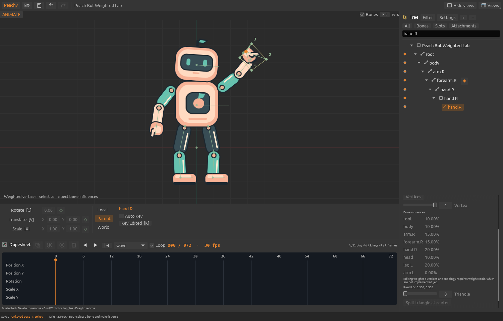
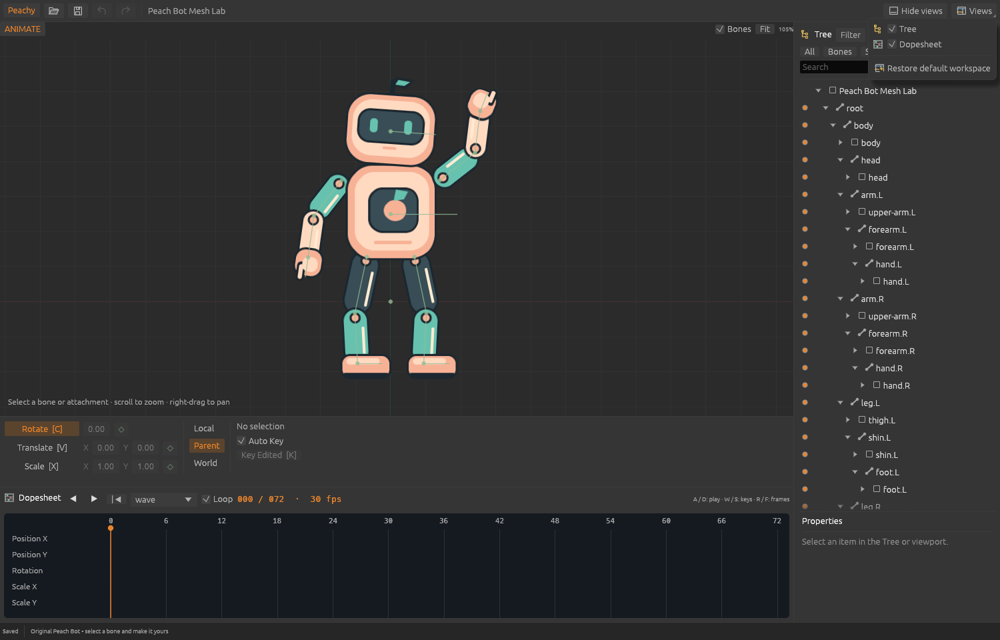

# Peachy Animator

A native 2D skeletal animation editor from Team Peachy, with an independent Rust
core and Spine-compatible exports. The current slices include Spine-style naming,
Dopesheet selection/retiming/clipboard actions, key-derived animation duration, and
weighted mesh import, bone-driven preview and read-only influence inspection.
This is still a bounded subset of Spine.



## Try it

Install Rust 1.95 or newer, including `rustfmt` and `clippy`, then run:

```sh
cargo run -p peachy-animator
```

The editor opens our original **Peach Bot** character: 15 bones, 14 slots, two
animations and peach/mint skins. Its artwork is generated from original geometric
shapes; no game assets or third-party example characters are included.
The demo uses the named `peach` or `mint` appearance in a consuming runtime;
`default` contains the shared parts that those skins inherit.

For the mesh demo, open **Mesh Lab.command**, or run:

```sh
cargo run -p peachy-animator -- examples/peach-bot/mesh-bot.peachy
```

For the weighted mesh demo:

```sh
cargo run -p peachy-animator -- examples/peach-bot/weighted-bot.peachy
```

Select its hand.R mesh attachment, then **Vertices**, to inspect the selected
vertex's bone influences. Weighted inspection works in Setup and Animate, including
an unkeyed pose. It stops playback and preserves the current pose and mode. Bone
transforms and animation move the weighted artwork; editing weights, weighted
vertices and weighted topology remains pending.

File/history shortcuts use compact icons with named shortcut tooltips. The Views
menu and view headings share the same visual cues; see the
[iconography contract](docs/ICONOGRAPHY.md).

Select a bone, slot or animation and use **F2**, double-click its Tree name, or
click the properties **Rename** icon. Animation properties also offer **Duplicate**;
the copy is selected for inspection while the active animation stays unchanged.
Click Dopesheet keys to select them, **Cmd/Ctrl-click** to toggle several, then
press **Delete** while the canvas has focus or click its Delete icon. Double-click
a key to delete it. Drag selected keys to retime them together; **Shift** disables
frame snapping and **Cmd/Ctrl+Shift-drag** duplicates them. **Cmd/Ctrl+C/X/V**
copies/cuts/pastes focused Dopesheet keys. Paste targets the selected bone at the
playhead, retaining relative timing and curves. The matching toolbar icons share
these actions. **Cmd/Ctrl+A** expands selection to its rows, then all shown keys;
with no selection it selects all shown keys immediately. Click a property row label
to select its Rotate/Translate/Scale tool. Escape cancels a live drag; each
committed edit is one undo step.

The workspace follows Spine’s default arrangement: viewport left, Tree and item
properties right, transform controls below the viewport, and Dopesheet below those
in Animate mode. UI parity is an ongoing acceptance requirement; see the
[UI parity contract](docs/UI_PARITY.md) for remaining differences.

For an unweighted mesh in Setup, expand the hand.R bone and slot, select its
mesh attachment, then choose **Vertices** in the attachment properties and drag a numbered vertex. The **Mesh** checkbox converts a region
to a four-corner mesh; existing mesh triangles can be split at their centers.
Setup vertex movement deforms the image while UVs stay fixed; each canvas
drag is one undo step, and Escape cancels the current drag.
This corresponds to Spine's setup vertex transforms. UV editing, freeform hull
creation, binding/weight editing and animated deform keys are not implemented yet.
Weighted vertex dragging, nudging, local-coordinate fields and subdivision are
blocked; selecting them never converts or normalizes their data.



1. Switch to **Animate** at the viewport's upper left; press **D** to play forward/stop, **A** backward/stop.
2. Select a bone or region attachment in the viewport or Tree; **C** rotates, **V**
   translates, and **X** scales. Attachment transforms are available in Setup.
3. Use the transform fields below the viewport. **L** keys the active transform;
   **Cmd/Ctrl+L** keys all supported transforms for the selected bone. With **Auto Key**
   off, pose first and press **K** to key every edited bone.
4. Scrub the Dopesheet; **W/S** jumps to next/previous key, **Q/E** to start/last key.
   Use **R/F** for next/previous frame and **Shift+R/F** for ten.
5. Undo/redo with **Cmd/Ctrl+Z** / **Cmd/Ctrl+Shift+Z**. Space deselects.
6. Save a `.peachy` project and use **Peachy → Export** or **Cmd/Ctrl+E**.

**Animate** edits create keys while **Auto Key** is on. With it off, orange key
buttons mark unkeyed edits; click a transform's key button, a bone's orange Tree
button, or press **K** (Key Edited). Green means no key; red means keyed at this frame.
Translate and scale use paired X/Y keys by default. Moving the timeline or starting
playback clears unkeyed edits. With no redo branch, Undo recovers the pose at the
new frame. Switching animation or mode clears the pending pose.

Save/export include setup data and animation keys; **unkeyed poses are excluded**.
The status bar calls out a pending pose even if the document itself is saved.
**Setup** edits change the underlying rig.
Animation length follows the highest key and shrinks when it moves or is deleted.
You can seek and pose beyond the last key; keying there extends the animation.
Empty clips and frame-zero-only clips both end at zero while retaining different
key data. The timeline keeps a positive display range independently of that end.
Local/Parent/World select transform coordinates. Numeric entry accepts relative
`+value`, `+-value`, `*factor` and `/divisor` on Enter/Tab. World scale entry uses
local values. Arrows nudge the active transform; Shift uses smaller steps; the **Fit** button fits the scene. Scroll zooms,
right-drag pans, and right-click switches the last two tools. **F9** hides/restores views.
**F12** captures the editor and a diagnostic project snapshot to a local temporary
capture folder. The app currently runs from its source checkout; an installer and
bundled-resource packaging are later work.

## Tree workflow

Select an item's **name** to inspect it. Use a skin or animation's **visibility dot**
to make it active. Activating a skin or animation does not dirty the project. Slot
visibility dots temporarily hide artwork; Cmd/Ctrl+H restores hidden items.
Attachment dots in Setup change the slot's saved setup attachment and support undo.

Page Up/Page Down browse selection history. Cmd/Ctrl+0–9 stores the selected item;
0–9 recalls it. Storing an empty selection clears a group. These session groups
currently hold one item each. Document Undo remains separate from selection history.

Search reveals matching branches. The Bones, Slots and Attachments filters provide
quick views; Slots lists the rig in draw order. When attachments are filtered out,
clicking artwork in the viewport selects its slot. Only the selected entity's
supported controls can edit it. Inactive skin attachments remain inspectable.

## What works

- Hierarchical bones with position, rotation and nonuniform scale.
- Layered region attachments, draw order, skins and default-skin fallback.
- A typed Tree for bones, slots, skin placeholders, attachments, skins and animations,
  with search, type filters, branch controls, temporary visibility and contextual properties.
- Shared commands for bone length, region setup transforms and a slot’s setup attachment.
- Unweighted meshes with explicit UVs, triangles and hulls, setup vertex editing,
  region conversion and triangle subdivision.
- Weighted meshes with typed bone-local influences, shared posed geometry for
  rendering/picking/bounds, read-only inspection and preserved import/export data.
- Deterministic timeline playback, scrubbing, frame stepping and looping.
- Scalar keys with linear, stepped and editable Bezier interpolation.
- Auto Key, unkeyed multi-bone posing, Key Edited (K), colored key indicators,
  explicit transform/Tree key buttons and pose-aware transactional history.
- Canvas manipulation, transform controls and adding child bones.
- Shared commands, atomic batch edits and undo/redo.
- JSON project saves with atomic replacement, verified timestamped backups and
  image copying when saving to another directory.
- Spine **4.3.x JSON** import/export for the supported subset. Desktop export
  creates a fresh directory with JSON, an atlas and its PNG page.
- A headless CLI that uses the same document, command and pose engine.

Binding, weight editing, linked meshes, IK, physics, path/transform constraints,
clipping, slot animation,
events, image sequences, packed-atlas import, native `.spine` files and animation
mixing are not implemented. Unsupported imports are blocked with a feature report;
the source remains untouched. The latest read-only artist audit still finds 0/11
fully supported characters: weighted-mesh refusals are gone, but all 11 require
constraints. Installed-editor re-export can quantize bind coordinates, remove zero
entries and reorder influences, so lossless editor round trips are not claimed.
See [the compatibility contract](docs/COMPATIBILITY.md).

## CLI

```sh
cargo run -p peachy-cli -- validate examples/peach-bot/peach-bot.peachy
cargo run -p peachy-cli -- pose examples/peach-bot/peach-bot.peachy wave 0.3
cargo run -p peachy-cli -- inspect /path/to/skeleton.json
cargo run -p peachy-cli -- import /path/to/skeleton.json new-project.peachy
cargo run -p peachy-cli -- export examples/peach-bot/peach-bot.peachy new-export.json
cargo run -p peachy-cli -- bundle examples/peach-bot/peach-bot.peachy /path/to/export-parent
cargo run -p peachy-cli -- apply input.peachy commands.json edited.peachy
```

CLI outputs must be new files; it refuses to overwrite existing output. The CLI
`export` command writes JSON only. Use the desktop exporter for a packed bundle.
The CLI `bundle` command uses that same shared exporter.
Native projects reference loose images in `images/` beside the project. Native
format v4 tags mesh vertices as `slotLocal` positions or `weighted` bone influences;
animation duration still follows its last key, including empty clips. The loader
migrates v1/v2/v3 projects in memory, preserving v2's previous exported hold keys and
wrapping legacy mesh positions. Loading leaves source bytes unchanged. Explicit
Save writes v4 and backs up the previous file; older binaries cannot open v4.
`pose` accepts an optional skin name and also emits evaluated attachment geometry.

## Architecture and verification

The design follows PhotoCraft's engine-first, command-driven architecture:
serializable documents, an independent animation engine, format adapters, and thin
desktop/CLI clients. No PhotoCraft application code was copied. See
[architecture](docs/ARCHITECTURE.md), [implementation provenance](docs/PROVENANCE.md),
and [the next slices](docs/ROADMAP.md).
The [workflow milestones](docs/WORKFLOWS.md) track import, edit, pose, animate, slots,
save and game-export hurdles against the current limitations.
The [Spine parity matrix](docs/PARITY.md) records implemented behavior, evidence,
and the remaining gaps by feature area.

```sh
cargo fmt --all -- --check
python3 scripts/check-architecture.py
cargo test --workspace --locked
cargo clippy --workspace --all-targets --locked -- -D warnings
cargo build --workspace --locked
```

The included GitHub workflow is manual-only. Hosted CI has not been run; the
initial verification was local on macOS.
The [code quality review](docs/CODE_QUALITY.md) records the subsequent boundary
refactor, corrected defects and checks for expanding the editor.

The optional external compatibility check needs Node.js and a **separately licensed**
Spine 4.3 runtime supplied by its absolute module path. It executes that runtime as
an oracle without copying its implementation into this project:

```sh
mkdir -p .local
cargo run -p peachy-cli -- export examples/peach-bot/peach-bot.peachy .local/peach-bot.json
node scripts/check-runtime.mjs /absolute/path/to/spine-core/dist/index.js
```

The official Spine runtimes are not dependencies of this application. Games using
those runtimes retain their applicable Spine licensing requirements. Our MIT license
covers our own source and original fixture; it does not relicense Esoteric Software's
tools or runtimes. Spine is a trademark of Esoteric Software. Team Peachy is independent
of Esoteric Software and the ArtCraft team.
