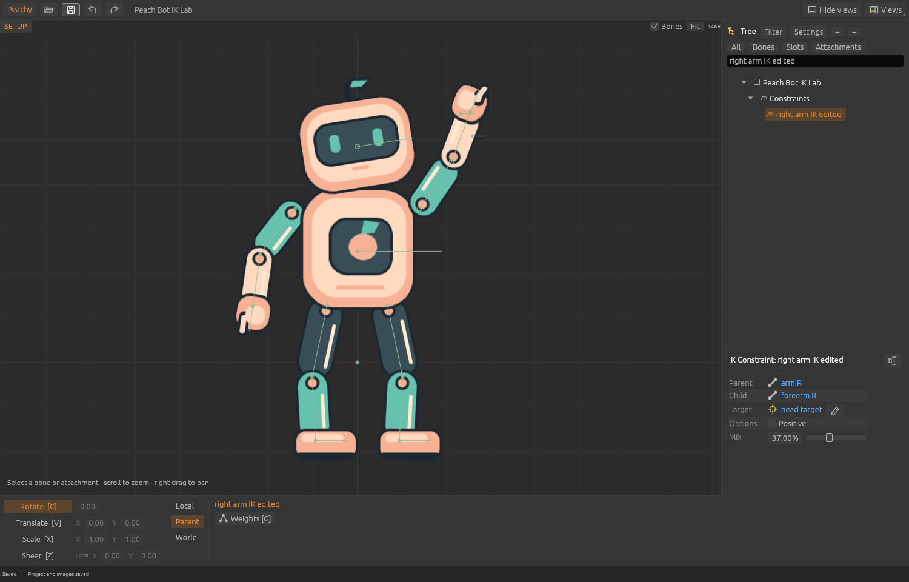
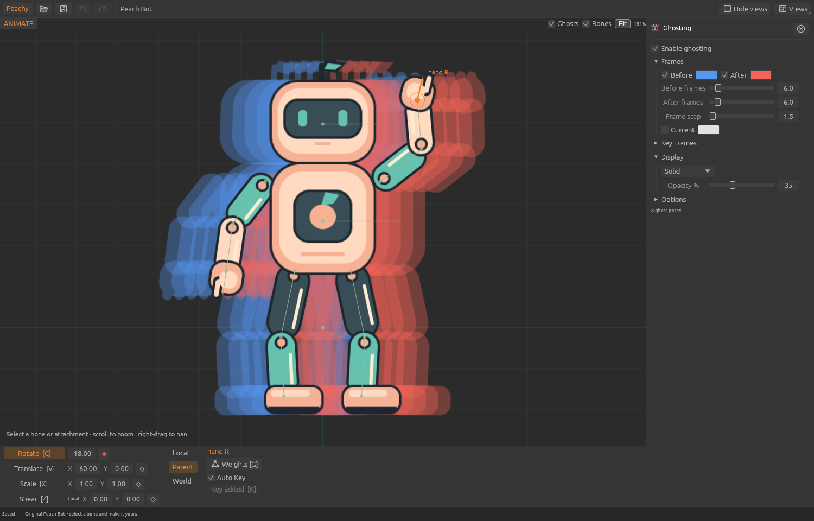
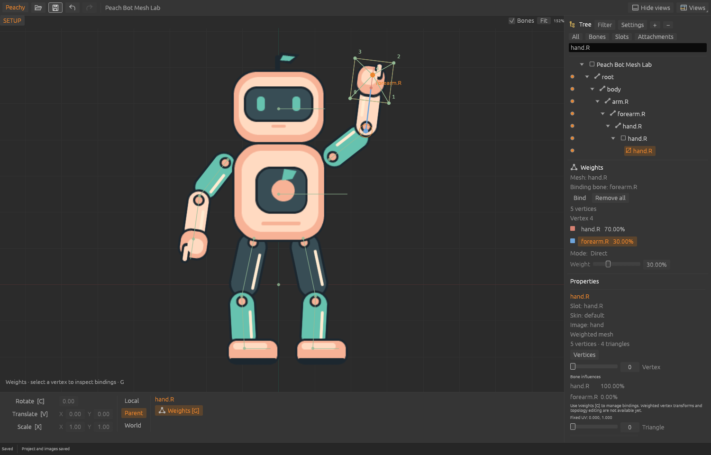

# Peachy Animator

This branch adds animated IK (keyed Mix/Positive) on native9 projects. See the
[review checkpoint](docs/IK_ANIMATION_REVIEW.md) for controls, verification and
the remaining raw-curve import precision issue. Interactive review is still pending.

A native 2D skeletal animation editor from Team Peachy, with an independent Rust
core and Spine-compatible exports. The current slices include Spine-style naming,
Dopesheet selection/retiming/clipboard actions, key-derived animation duration, and
weighted mesh import, bone-driven preview, binding, single-vertex Direct weights,
bone shear authoring, and bounded one-/two-bone inverse kinematics (IK).
This is still a bounded subset of Spine.



## Try it

Install Rust 1.95 or newer, including `rustfmt` and `clippy`, then run:

```sh
cargo run -p peachy-animator
```

The editor opens our original **Peach Bot** character: 15 bones, 14 slots, two
animations and peach/mint skins. Its artwork is generated from original geometric
shapes; no game assets or third-party example characters are included.
The demo uses the named `peach` or `mint` appearance in a consuming runtime;
`default` contains the shared parts that those skins inherit.

For the mesh demo, open **Mesh Lab.command**, or run:

```sh
cargo run -p peachy-animator -- examples/peach-bot/mesh-bot.peachy
```

For the weighted mesh demo:

```sh
cargo run -p peachy-animator -- examples/peach-bot/weighted-bot.peachy
```

The original Shear Lab adds reflected/nonuniform parents, nonzero setup shear and
linear, stepped and Bezier shear clips across region and mesh artwork:

```sh
cargo run -p peachy-animator -- examples/peach-bot/shear-bot.peachy
```

Select a bone and press **Z** for Shear. Both numeric axes and explicit handles are
available; exact installed-Spine empty-space/Shift behavior and World/Parent display
remain comparison gates. See [the current UI scope](docs/slices/shear-ui.md).

The original IK Lab adds two targets, one-/two-bone constraints and target animation:

```sh
cargo run -p peachy-animator -- examples/peach-bot/ik-bot.peachy
```

Select a constraint in the Tree's **Constraints** folder. Setup properties expose
Mix, two-bone Positive, linked bones, target replacement and Rename. Move a target
to pose its chain; authored bone values remain separate from solved values.
Constraint settings are static in this slice. See [the IK contract](docs/slices/ik-design.md)
for its chain, transform and precision limits.

The original Physics Lab adds three physics constraints with keyed settings,
global wind keys and reset keys:

```sh
cargo run -p peachy-animator -- examples/peach-bot/physics-bot.peachy
```

Select a physics constraint in the Tree's **Constraints** folder to edit its
Setup settings and Global flags. Physics is saved and exported for the game
runtime, but the editor preview does not simulate it yet. See
[physics data](docs/slices/physics-data.md).

The original Inherit Lab sets every bone inheritance mode, scales, shears and
mirrors the body, and keys mode changes:

```sh
cargo run -p peachy-animator -- examples/peach-bot/inherit-bot.peachy
```

Select a bone to see its **Inherit** Rotation/Scale/Reflection checkboxes.

The original Transform Lab mirrors one hand's movement, aims the head along an
arm and spins a foot with a large rotation offset:

```sh
cargo run -p peachy-animator -- examples/peach-bot/transform-bot.peachy
```

The original Skin Lab has a badge bone, slot and IK aim that exist only in the
mint skin; switch skins in the Tree to see them appear:

```sh
cargo run -p peachy-animator -- examples/peach-bot/skin-bot.peachy
```

The original Deform Lab keys the shapes of the weighted hand and the peach
body mesh (Animate, `wave`):

```sh
cargo run -p peachy-animator -- examples/peach-bot/deform-bot.peachy
```

The original Slot Lab swaps the left hand's image, hides it, and keys head and
body colors (Animate, `wave`):

```sh
cargo run -p peachy-animator -- examples/peach-bot/slot-bot.peachy
```

The original Transform Map Lab remaps a mirrored hand with offsets and scales
and clamps the left foot to a box (Animate, `wave`):

```sh
cargo run -p peachy-animator -- examples/peach-bot/transform-map-bot.peachy
```

The original Linked Mesh Lab swaps the right hand to linked meshes that follow
or ignore its deform keys, and links the mint body to the peach body across
skins (Animate, `wave`; switch skins):

```sh
cargo run -p peachy-animator -- examples/peach-bot/linked-mesh-bot.peachy
```

The original Tint Lab tints attachments on top of keyed slot colors and keys a
curve that overshoots between equal values (Animate, `wave`):

```sh
cargo run -p peachy-animator -- examples/peach-bot/tint-bot.peachy
```

The original Draw Order Lab moves the left arm in front, sends the head to the
back and then restores setup order (Animate, `wave`):

```sh
cargo run -p peachy-animator -- examples/peach-bot/draw-order-bot.peachy
```

For either mesh fixture, select its hand.R attachment and **Vertices** to inspect the selected
vertex's bone influences. Weighted inspection works in Setup and Animate, including
an unkeyed pose. It stops playback and preserves the current pose and mode. Bone
transforms and animation move the weighted artwork. Press **G** for the Weights
view to bind bones or adjust one vertex's weights. Weighted vertex-position and
topology editing remain pending.

File/history shortcuts use compact icons with named shortcut tooltips. The Views
menu and view headings share the same visual cues; see the
[iconography contract](docs/ICONOGRAPHY.md).

Select a bone, slot or animation and use **F2**, double-click its Tree name, or
click the properties **Rename** icon. Animation properties also offer **Duplicate**;
the copy is selected for inspection while the active animation stays unchanged.
Click Dopesheet keys to select them, **Cmd/Ctrl-click** to toggle several, then
press **Delete** while the canvas has focus or click its Delete icon. Double-click
a key to delete it. Drag selected keys to retime them together; **Shift** disables
frame snapping and **Cmd/Ctrl+Shift-drag** duplicates them. **Cmd/Ctrl+C/X/V**
copies/cuts/pastes focused Dopesheet keys. Paste targets the selected bone at the
playhead, retaining relative timing and curves. The matching toolbar icons share
these actions. **Cmd/Ctrl+A** expands selection to its rows, then all shown keys;
with no selection it selects all shown keys immediately. Click a property row label
to select its Rotate/Translate/Scale tool. Escape cancels a live drag; each
committed edit is one undo step.

The workspace follows Spine’s default arrangement: viewport left, Tree and item
properties right, transform controls below the viewport, and Dopesheet below those
in Animate mode. UI parity is an ongoing acceptance requirement; see the
[UI parity contract](docs/UI_PARITY.md) for remaining differences.

**Views** also opens Animations, Ghosting and Playback (in Animate), Skins, Metrics and Outline. These
share a resizable tabbed panel in the right rail. Outline displays the current
pose without editing handles; Animations and Skins switch the active preview
without changing the saved document. Playback adds a shared preview-speed slider,
percentage presets and transport that works with Dopesheet closed. Its Timeline
FPS display is read-only; FPS retiming and interpolation overrides are pending.
Ghosting adds before/after onion skins, a keyed **Current** comparison, tint and
solid-color display, frame/key sampling, offsets and selection controls. Enable it
in its panel or with **Ghosts** above the viewport.



All **15 Views** now have functional bounded implementations; [VIEWS.md](docs/VIEWS.md)
records each scope and remaining parity gaps.

**Views → Audio** loads a session-only WAV waveform with independent audition,
seek, zoom/pan, Loop, Volume and Mute. Playback uses native macOS output; other
platforms support waveform inspection. Audio events, synchronization and export
remain pending; audition data does not become part of the project.

**Views → Graph** shows the selected bone's keyed transform values and edits them
with vertical key dragging. Exact-key selection preserves close native times;
timing and curves stay fixed. Tangents, retiming and multiple curves remain pending.

**Views → Preview** plays a keyed animation and skin on an independent clock while
you edit Setup or another pose. It has its own transport, speed, pan/zoom and Fit;
pending unkeyed edits stay in the main editor. Mixing and multiple tracks remain pending.

**Views → Mesh Tools** provides Size, Feather and Hull vertices for soft selection
while dragging or nudging unweighted Setup vertices. Neighbors use a linear falloff;
a drag is one Undo step. Weighted soft selection and Rotate/Scale remain pending.

**Views → Timeline** opens a compact ruler below the viewport, with playback,
frame/key navigation, decimal frame entry, key markers, scrubbing, zoom and pan.
It shares the current animation and works with Dopesheet closed.

The menu lists the remaining Spine views
with an explanation of each missing feature. See [the complete inventory](docs/VIEWS.md).

For an unweighted mesh in Setup, expand the hand.R bone and slot, select its
mesh attachment, then choose **Vertices** in the attachment properties and drag a numbered vertex. The **Mesh** checkbox converts a region
to a four-corner mesh; existing mesh triangles can be split at their centers.
Setup vertex movement deforms the image while UVs stay fixed; each canvas
drag is one undo step, and Escape cancels the current drag.
This corresponds to Spine's setup vertex transforms. UV editing, freeform hull
creation and animated deform keys are not implemented yet.
Weighted vertex dragging, nudging, local-coordinate fields and subdivision are
blocked; selecting them never converts or normalizes their data.


1. Switch to **Animate** at the viewport's upper left; press **D** to play forward/stop, **A** backward/stop.
2. Select a bone or region attachment in the viewport or Tree; **C** rotates, **V**
   translates, and **X** scales. Attachment transforms are available in Setup.
3. Use the transform fields below the viewport. **L** keys the active transform;
   **Cmd/Ctrl+L** keys all supported transforms for the selected bone. With **Auto Key**
   off, pose first and press **K** to key every edited bone.
4. Scrub the Dopesheet; **W/S** jumps to next/previous key, **Q/E** to start/last key.
   Use **R/F** for next/previous frame and **Shift+R/F** for ten.
5. Undo/redo with **Cmd/Ctrl+Z** / **Cmd/Ctrl+Shift+Z**. Space deselects.
6. Save a `.peachy` project and use **Peachy → Export** or **Cmd/Ctrl+E**.

**Animate** edits create keys while **Auto Key** is on. With it off, orange key
buttons mark unkeyed edits; click a transform's key button, a bone's orange Tree
button, or press **K** (Key Edited). Green means no key; red means keyed at this frame.
Translate and scale use paired X/Y keys by default. Moving the timeline or starting
playback clears unkeyed edits. With no redo branch, Undo recovers the pose at the
new frame. Switching animation or mode clears the pending pose.

Save/export include setup data and animation keys; **unkeyed poses are excluded**.
The status bar calls out a pending pose even if the document itself is saved.
**Setup** edits change the underlying rig.
Animation length follows the highest key and shrinks when it moves or is deleted.
You can seek and pose beyond the last key; keying there extends the animation.
Empty clips and frame-zero-only clips both end at zero while retaining different
key data. The timeline keeps a positive display range independently of that end.
Local/Parent/World select transform coordinates. Numeric entry accepts relative
`+value`, `+-value`, `*factor` and `/divisor` on Enter/Tab. World scale entry uses
local values. Arrows nudge the active transform; Shift uses smaller steps; the **Fit** button fits the scene. Scroll zooms,
right-drag pans, and right-click switches the last two tools. **F9** hides/restores views.
**F12** captures the editor and a diagnostic project snapshot to a local temporary
capture folder. The app currently runs from its source checkout; an installer and
bundled-resource packaging are later work.

## Bind a mesh

Select an active unweighted mesh attachment, press **G** to open the Weights tool
and view, then click **Bind** and click one bone in the Tree or viewport. You can
also select one bone first, click Bind, then click an active unweighted mesh.
The first binding gives every vertex one influence at 100%. Entering Bind mode
alone makes no document edit; Space/Escape exits without rolling back completed work.

For a weighted mesh, **Remove all** removes every bound bone while preserving its
current shape. These operations capture the current Setup or Animate pose, pause
playback, and preserve the frame and unkeyed bone edits. Save stores the resulting
mesh data; key the bone pose separately if it must survive save/reopen or playback.
The Weights mesh/vertex selection survives switching to bone transform tools and
back with G. Normal bone edits still target the normal Tree selection.

For an already weighted mesh, **Bind** adds a genuinely new bone at 0% on every
vertex, preserving the old entries and current shape. A bone already present
anywhere in the mesh, including at 0%, is rejected; this does not repair sparse
imported bindings.

Select one vertex and one bound bone in Weights. **Mode: Direct** exposes a
**Weight** slider and percentage field. Starting with A=100%, Bind B=0%, then set
B to 30: only that vertex becomes A=70%, B=30%. Other positive weights share the
remainder proportionally; bind positions and influence order stay unchanged.
An explicit edit can normalize an imported nonunit total on that vertex and may
deform it. Import, inspection, focusing a rounded value, and adding a zero binding
do not normalize the data.

Release the slider or use Enter/Tab to commit one undo step. Escape or Undo/Redo
cancels an active preview; Save/Export and context changes cancel before continuing.
Direct captures one pose for the gesture and preserves pending bone edits without
keying them. Save excludes that unkeyed pose as before. Ambiguous repeated bones,
missing selected-vertex bindings and reducing the sole positive weight without a
recipient are guarded limits of this slice.

Brush painting, Auto, locks, Update, multiple vertex/bone selection and individual
bone removal remain pending.
The resizable Weights pane uses the existing right column; exact Spine dock
placement is provisional. See the [binding contract](docs/slices/weight-authoring.md),
[Direct command contract](docs/slices/weight-direct-design.md),
[controls and gesture contract](docs/slices/weight-direct.md), and
[validation](docs/VALIDATION.md#additional-binding-and-direct--november-6-2026-utc).




## Tree workflow

Select an item's **name** to inspect it. Use a skin or animation's **visibility dot**
to make it active. Activating a skin or animation does not dirty the project. Slot
visibility dots temporarily hide artwork; Cmd/Ctrl+H restores hidden items.
Attachment dots in Setup change the slot's saved setup attachment and support undo.

Page Up/Page Down browse selection history. Cmd/Ctrl+0–9 stores the selected item;
0–9 recalls it. Storing an empty selection clears a group. These session groups
currently hold one item each. Document Undo remains separate from selection history.

Search reveals matching branches. The Bones, Slots and Attachments filters provide
quick views; Slots lists the rig in draw order. When attachments are filtered out,
clicking artwork in the viewport selects its slot. Only the selected entity's
supported controls can edit it. Inactive skin attachments remain inspectable.

## What works

- Hierarchical bones with position, rotation and nonuniform scale.
- Layered region attachments, draw order, skins and default-skin fallback.
- A typed Tree for bones, slots, skin placeholders, attachments, skins and animations,
  with search, type filters, branch controls, temporary visibility and contextual properties.
- Shared commands for bone length, region setup transforms and a slot’s setup attachment.
- Unweighted meshes with explicit UVs, triangles and hulls, setup vertex editing,
  region conversion and triangle subdivision.
- Weighted meshes with typed bone-local influences, shared posed geometry for
  rendering/picking/bounds, read-only inspection and preserved import/export data.
- A G Weights tool/view, initial one-bone Bind and Remove all at the current pose,
  preserving shape, pending bone pose and time through shared engine commands.
- Additional zero-weight bindings and Direct percentage editing of one vertex and
  one bound bone, with proportional redistribution and transactional previews.
- Deterministic timeline playback, scrubbing, frame stepping and looping.
- A separate compact Timeline with shared transport, fractional frame entry,
  all-track key markers, snapped/subframe seeking, pan and zoom.
- Ghosting with frame/key onion skins, pending-pose comparison, tinted or solid
  rendering, anchor/loop/offset controls and a lockable bone selection filter.
- Scalar keys with linear, stepped and editable Bezier interpolation.
- Auto Key, unkeyed multi-bone posing, Key Edited (K), colored key indicators,
  explicit transform/Tree key buttons and pose-aware transactional history.
- Canvas manipulation, transform controls and adding child bones.
- Shared commands, atomic batch edits and undo/redo.
- Static one-/two-bone normal IK with animated targets, constraint Tree properties,
  and pose-aware binding/transform tools within the supported chain subset.
- JSON project saves with atomic replacement, verified timestamped backups and
  image copying when saving to another directory.
- Spine **4.3.x JSON** import/export for the supported subset. Desktop export
  creates a fresh directory with JSON, an atlas and its PNG page.
- A headless CLI that uses the same document, command and pose engine.

Brush weight editing, multi-vertex/multi-bone weights, Update bindings, linked meshes,
IK timelines and advanced/dependent chains, physics, path/transform constraints,
clipping, slot animation,
events, image sequences, packed-atlas import, native `.spine` files and animation
mixing are not implemented. Unsupported imports are blocked with a feature report;
the source remains untouched. The latest read-only artist audit still finds 0/11
fully supported characters: weighted-mesh refusals are gone, but all 11 require
constraints. Installed-editor re-export can quantize bind coordinates and positive
weights, remove zero entries and reorder influences, so lossless editor round trips
are not claimed.
See [the compatibility contract](docs/COMPATIBILITY.md).

## CLI

```sh
cargo run -p peachy-cli -- validate examples/peach-bot/peach-bot.peachy
cargo run -p peachy-cli -- pose examples/peach-bot/peach-bot.peachy wave 0.3
cargo run -p peachy-cli -- inspect /path/to/skeleton.json
cargo run -p peachy-cli -- import /path/to/skeleton.json new-project.peachy
cargo run -p peachy-cli -- export examples/peach-bot/peach-bot.peachy new-export.json
cargo run -p peachy-cli -- bundle examples/peach-bot/peach-bot.peachy /path/to/export-parent
cargo run -p peachy-cli -- apply input.peachy commands.json edited.peachy
```

CLI outputs must be new files; it refuses to overwrite existing output. The CLI
`export` command writes JSON only. Use the desktop exporter for a packed bundle.
The CLI `bundle` command uses that same shared exporter.
Native projects reference loose images in `images/` beside the project. Native
format v7 requires exact four-byte setup RGBA on every slot, an ordered constraints list, bone shear X/Y and tagged `slotLocal`/`weighted` mesh
vertices. Animation duration follows its last key, including empty clips. The loader
migrates v1–v6 projects in memory, preserving legacy holds/vertices, adding
zero shear, empty constraints and white slot colors where needed. Loading leaves source bytes unchanged. Explicit Save
writes v7 and backs up the previous file; older binaries cannot open v7. Bone
command payloads require all seven transform fields. `pose` accepts an optional
skin name and emits authored locals, applied locals, world transforms and attachment geometry; unsupported or nonfinite evaluation fails
explicitly before JSON output.

## Architecture and verification

Agents can work without opening a window through the standalone MCP server:

```sh
cargo build -p peachy-mcp --locked
./target/debug/peachy-mcp --root /absolute/path/to/animation-workspace
```

It communicates over stdio and exposes project inspection, validated command
batches, undo/redo, pose evaluation and new-output saves/exports through the same
engine as the desktop. Each server owns an independent session; it does not
control an existing editor window. See [MCP setup, tools and limits](docs/MCP.md)
for client configuration and a complete workflow.

The design follows PhotoCraft's engine-first, command-driven architecture:
serializable documents, an independent animation engine, format adapters, and thin
desktop/CLI clients. No PhotoCraft application code was copied. See
[architecture](docs/ARCHITECTURE.md), [implementation provenance](docs/PROVENANCE.md),
and [the next slices](docs/ROADMAP.md).
The [workflow milestones](docs/WORKFLOWS.md) track import, edit, pose, animate, slots,
save and game-export hurdles against the current limitations.
The [Spine parity matrix](docs/PARITY.md) records implemented behavior, evidence,
and the remaining gaps by feature area.

```sh
cargo fmt --all -- --check
python3 scripts/check-architecture.py
cargo test --workspace --locked
cargo clippy --workspace --all-targets --locked -- -D warnings
cargo build --workspace --locked
```

The included GitHub workflow is manual-only. Hosted CI has not been run; the
initial verification was local on macOS.
The [code quality review](docs/CODE_QUALITY.md) records the subsequent boundary
refactor, corrected defects and checks for expanding the editor.

The optional external compatibility check needs Node.js and a **separately licensed**
Spine 4.3 runtime supplied by its absolute module path. It executes that runtime as
an oracle without copying its implementation into this project:

```sh
mkdir -p .local
cargo run -p peachy-cli -- export examples/peach-bot/peach-bot.peachy .local/peach-bot.json
node scripts/check-runtime.mjs /absolute/path/to/spine-core/dist/index.js
```

The official Spine runtimes are not dependencies of this application. Games using
those runtimes retain their applicable Spine licensing requirements. Our MIT license
covers our own source and original fixture; it does not relicense Esoteric Software's
tools or runtimes. Spine is a trademark of Esoteric Software. Team Peachy is independent
of Esoteric Software and the ArtCraft team.
