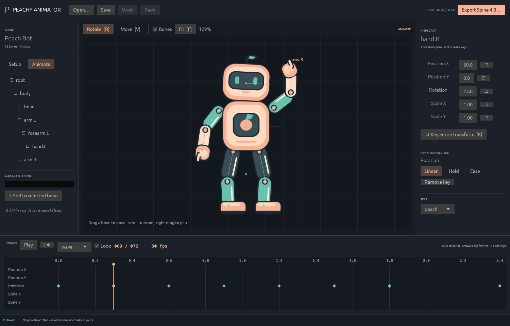
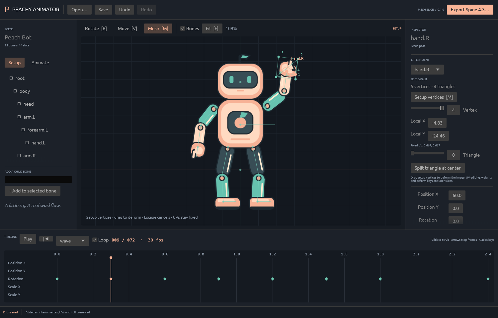

# Peachy Animator

A native 2D skeletal animation editor from Team Peachy, with an independent Rust
core and Spine-compatible exports. The current slice adds editable unweighted
meshes; this is still a bounded subset of Spine.



## Try it

Install Rust 1.95 or newer, including `rustfmt` and `clippy`, then run:

```sh
cargo run -p peachy-animator
```

The editor opens our original **Peach Bot** character: 15 bones, 14 slots, two
animations and peach/mint skins. Its artwork is generated from original geometric
shapes; no game assets or third-party example characters are included.
The demo uses the named `peach` or `mint` appearance in a consuming runtime;
`default` contains the shared parts that those skins inherit.

For the mesh demo, open **Mesh Lab.command**, or run:

```sh
cargo run -p peachy-animator -- examples/peach-bot/mesh-bot.peachy
```

Select **Mesh [M]** to enter Setup, then drag a numbered vertex. The attachment
inspector can convert a region to a four-corner mesh or split a triangle at its
center. Setup vertex movement deforms the image while UVs stay fixed; each canvas
drag is one undo step, and Escape cancels the current drag.
This corresponds to Spine's setup vertex transforms. UV editing, freeform hull
creation, weights and animated deform keys are not implemented yet.



1. Press **Space** to play/pause, or click the timeline to scrub.
2. Select a bone in the scene or hierarchy. Drag in **Rotate** or **Move** mode.
3. Adjust the inspector or press **K** to key the transform at the playhead.
4. Select a key's frame and choose Linear, Hold, or Ease. Ease exposes Bezier handles.
5. Undo/redo with **Cmd/Ctrl+Z** / **Cmd/Ctrl+Shift+Z**.
6. Save a `.peachy` project, reopen it, then choose **Export Spine 4.3…**.

**Animate** edits create keys. **Setup** edits change the underlying rig.
Arrow keys step frames; **F** fits the scene; scroll zooms; right-drag pans.
**F12** captures the editor and a diagnostic project snapshot to a local temporary
capture folder. The app currently runs from its source checkout; an installer and
bundled-resource packaging are later work.

## What works

- Hierarchical bones with position, rotation and nonuniform scale.
- Layered region attachments, draw order, skins and default-skin fallback.
- Unweighted meshes with explicit UVs, triangles and hulls, setup vertex editing,
  region conversion and triangle subdivision.
- Deterministic timeline playback, scrubbing, frame stepping and looping.
- Scalar keys with linear, stepped and editable Bezier interpolation.
- Canvas manipulation, transform controls and adding child bones.
- Shared commands, atomic batch edits and undo/redo.
- JSON project saves with atomic replacement, verified timestamped backups and
  image copying when saving to another directory.
- Spine **4.3.x JSON** import/export for the supported subset. Desktop export
  creates a fresh directory with JSON, an atlas and its PNG page.
- A headless CLI that uses the same document, command and pose engine.

Weights, linked meshes, IK, physics, path/transform constraints, clipping, slot animation,
events, image sequences, packed-atlas import, native `.spine` files and animation
mixing are not implemented. Unsupported imports are blocked with a feature report;
the source remains untouched. See [the compatibility contract](docs/COMPATIBILITY.md).

## CLI

```sh
cargo run -p peachy-cli -- validate examples/peach-bot/peach-bot.peachy
cargo run -p peachy-cli -- pose examples/peach-bot/peach-bot.peachy wave 0.3
cargo run -p peachy-cli -- inspect /path/to/skeleton.json
cargo run -p peachy-cli -- import /path/to/skeleton.json new-project.peachy
cargo run -p peachy-cli -- export examples/peach-bot/peach-bot.peachy new-export.json
cargo run -p peachy-cli -- bundle examples/peach-bot/peach-bot.peachy /path/to/export-parent
cargo run -p peachy-cli -- apply input.peachy commands.json edited.peachy
```

CLI outputs must be new files; it refuses to overwrite existing output. The CLI
`export` command writes JSON only. Use the desktop exporter for a packed bundle.
The CLI `bundle` command uses that same shared exporter.
Native projects reference loose images in `images/` beside the project. Native
format v2 uses tagged attachments; the loader migrates v1 region projects in memory.
Saving writes v2 and backs up the previous file. Older binaries cannot open v2.
`pose` accepts an optional skin name and also emits evaluated attachment geometry.

## Architecture and verification

The design follows PhotoCraft's engine-first, command-driven architecture:
serializable documents, an independent animation engine, format adapters, and thin
desktop/CLI clients. No PhotoCraft application code was copied. See
[architecture](docs/ARCHITECTURE.md), [implementation provenance](docs/PROVENANCE.md),
and [the next slices](docs/ROADMAP.md).
The [Spine parity matrix](docs/PARITY.md) records implemented behavior, evidence,
and the remaining gaps by feature area.

```sh
cargo fmt --all -- --check
python3 scripts/check-architecture.py
cargo test --workspace --locked
cargo clippy --workspace --all-targets --locked -- -D warnings
cargo build --workspace --locked
```

The included GitHub workflow is manual-only. Hosted CI has not been run; the
initial verification was local on macOS.
The [code quality review](docs/CODE_QUALITY.md) records the subsequent boundary
refactor, corrected defects and checks for expanding the editor.

The optional external compatibility check needs Node.js and a **separately licensed**
Spine 4.3 runtime supplied by its absolute module path. It executes that runtime as
an oracle without copying its implementation into this project:

```sh
mkdir -p .local
cargo run -p peachy-cli -- export examples/peach-bot/peach-bot.peachy .local/peach-bot.json
node scripts/check-runtime.mjs /absolute/path/to/spine-core/dist/index.js
```

The official Spine runtimes are not dependencies of this application. Games using
those runtimes retain their applicable Spine licensing requirements. Our MIT license
covers our own source and original fixture; it does not relicense Esoteric Software's
tools or runtimes. Spine is a trademark of Esoteric Software. Team Peachy is independent
of Esoteric Software and the ArtCraft team.
