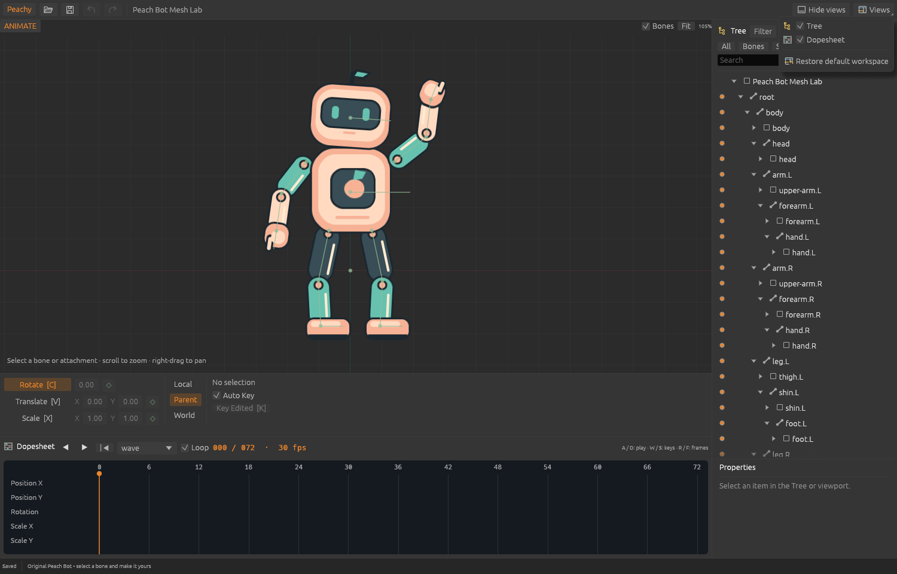

# Interface iconography

The user requires familiar visual cues as part of Spine usability parity. Plain
text is insufficient for the file/history controls and Views menu. This first pass
covers those controls with independently drawn vectors and a shared vocabulary.

| Control | Cue | Treatment |
| --- | --- | --- |
| Open Project | Open folder | Compact titlebar button; name and shortcut tooltip; same icon in file menu |
| Save | Floppy disk | Compact titlebar button; name and shortcut tooltip; same icon in file menu |
| Undo / Redo | Curved arrows pointing backward / forward | Enabled only when their history operation is available |
| Export | Arrow leaving a tray | File menu, beside its label and shortcut |
| Rename | Text with an insertion caret | Compact properties action; F2 tooltip |
| Duplicate animation | Overlapping pages | Compact properties action with a named tooltip |
| Copy / Cut / Paste keys | Overlapping pages / scissors / clipboard | Dopesheet toolbar; shortcut tooltips and contextual availability |
| Delete selected keys | Cross inside a circle | Dopesheet toolbar; availability follows selected keys |
| Views | Divided window | Menu heading with a dropdown corner cue |
| Tree | Connected hierarchy boxes | Same warm hierarchy icon in Views and Tree heading |
| Dopesheet | Timeline lanes with colored keys | Same icon in Views and Dopesheet heading; unavailable state remains dimmed in Setup |
| Restore default workspace | Window layout with a return arrow | Full labelled menu row |
| Hide / Restore views | Minimize bar / overlapping windows | Label and icon change together; F9 tooltip |

The icon shapes are code-native drawings on a 16-point grid. They use the existing
egui painter and follow display scaling, with no icon font, bitmap atlas, new crate
or network dependency. Button atoms reserve real layout space for each icon; there
are no text-space or Unicode-glyph stand-ins. The controls use egui button/checkbox interaction,
keyboard focus and popup menus. View visibility rows expose checkbox
roles and selected state; compact file/history buttons expose accessible names.

[File menu](icons-file-menu.png) · [Setup availability](icons-setup.png) ·
[Disabled-control tooltip](icons-tooltip.png)

Reference: the public [UI guide](https://esotericsoftware.com/spine-ui) and
[Views guide](https://esotericsoftware.com/spine-views), including titlebar and Views
menu images inspected November 5, 2026. These informed the visual meanings and
placement. No reference image, font or icon was extracted or copied into this app.
Reference downloads stay outside Git. This is semantic cue alignment, not a pixel
matching claim or complete icon coverage. Tool, filter, property and other view icons
remain part of continued UI parity work.
