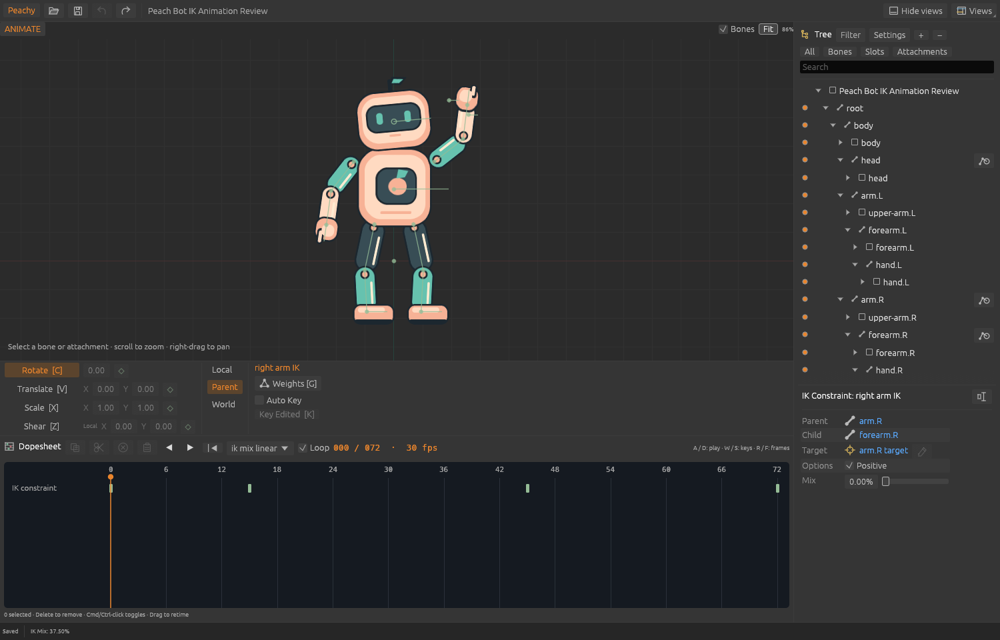

# Animated IK review checkpoint

This is a review build of the animated-IK slice, now native9. It adds animated Mix/Positive,
grouped IK Dopesheet keys, typed retiming/clipboard actions and shared bone/IK
pending poses with atomic keying/history. The original Animation Lab has eleven
clips, including IK-only, linear, stepped, Bezier, signed-Mix and target motion.

```sh
cargo run -p peachy-animator -- examples/peach-bot/ik-animation-bot.peachy
```

Switch to Animate, select an IK constraint, and use Mix/Positive, Auto Key or
Key Edited. D plays/stops; the animation picker offers the different examples.
Project saves use `.peachy` native9 (after native7 slot color and native8 physics).
Older builds cannot open these saves; native1–8 files migrate on load.



The exact implementation checkpoint `c82d160` passes 344 Rust tests, formatting,
warnings-denied Clippy and the workspace build. Architecture checks pass. Ten
original packed fixtures pass the separately licensed public runtime comparison
for every clip/skin: 479,232 bone values, 472,160 region coordinates, 75,400 mesh
coordinates and 4,992 IK pose groups. Inputs remain unchanged. Real OS input
verifies typed pending Mix, Undo/Redo and an unchanged document/file before an
intentional review handoff. The complete prepared native acceptance script has
not been run; this smoke check does not establish full interaction parity.

One material compatibility issue remains: importing noncanonical raw IK curve
numbers can lose precision in the current f32 key/control model. Original large
cancellation cases produce visible pose differences. The export-time rounding
bug is corrected and covered by eight regressions, but the broader raw import
correction is still planned in [the precision contract](slices/ik-raw-precision.md).
This checkpoint is therefore not accepted as completed animated-IK compatibility.
IK Graph/curve authoring, exact installed-editor row/shortcut comparison and
broader constraints remain separate gaps. Full production-rig support stays 0/11.

Evidence: `evidence/ik-animation-review-checks.json`,
`ik-animation-review-runtime.json`, `ik-animation-review-native.json` and
`ik-animation-raw-precision.json`. All committed captures/data use original art.


## Native9 integration — November 9, 2026

The 16 review commits were merged onto `main` (physics data, nested IK chains,
off-axis children, Views and slot color) as **native9**: `…→7 slot color →8
physics →9 ik_tracks`. Formats 1–8 refuse `ik_tracks`; formats 6–8 keep static
Mix within 0–1 before native9 accepts signed or overshooting Mix. IK tracks and
`SetIkKey` must address IK constraints; physics constraints share the ordered list
and receive an inactive IK placeholder in sampled poses. The CLI `ikPoses` output
lists IK constraints only, each with its true constraint index. The animated
solver keeps main's nested-chain order and off-axis child geometry. The five new
key commands are published in the MCP schema.

Verification of the integrated build: **480** Rust tests pass (1 ignored), with
format, warnings-denied Clippy, build and architecture checks. All 12 original
example fixtures pass the external 4.3.13 runtime; the Animation Lab compares
175,032 bone values, 3,432 IK pose groups (max Mix error 8.3e-17), 160,160
region and 28,600 mesh coordinates. The 19-skeleton game audit stays at 2/19,
inputs unchanged. Native OS input was not rerun for this integration.

Still open: the raw IK-curve import precision correction
([contract](slices/ik-raw-precision.md)) and **the user's interactive review** of
the animated editor. This integration does not accept the slice on their behalf.
