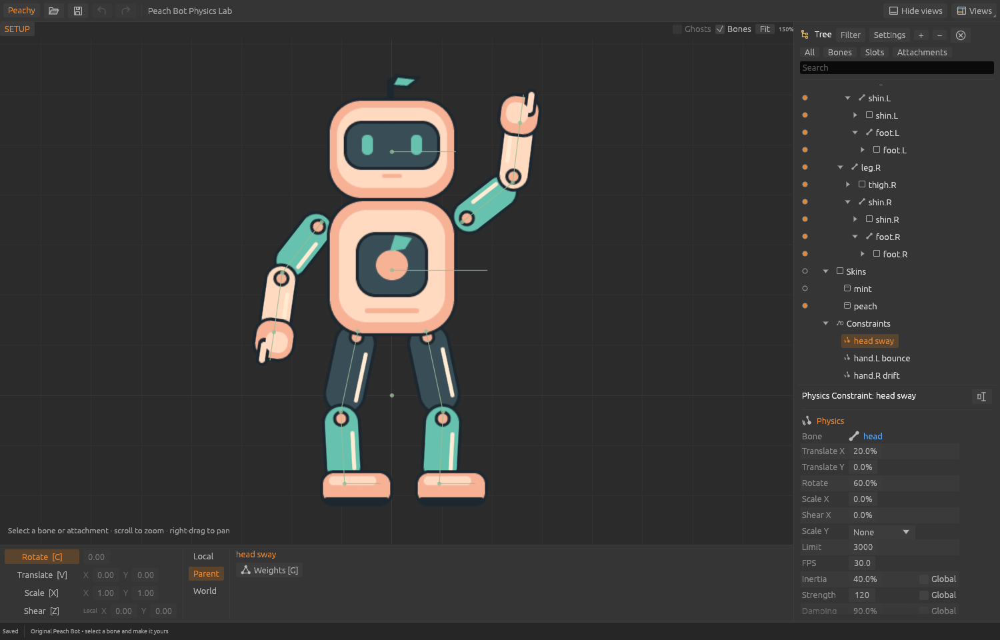

# Physics constraints as data — November 9, 2026

Every one of the game's 19 shipped Spine skeletons uses physics constraints (469 in
total), so none could be opened before this slice. This slice makes physics
**lossless data**: import, inspect, edit Setup settings, save, and export unchanged
for the game runtime, which performs the simulation.

## Scope

- Native v8 `Constraint::Physics`: bone, five property influences (Translate X/Y,
  Rotate, Scale X, Shear X), Scale Y mode (None/Uniform/Volume), Limit, FPS, the
  seven keyable settings (Inertia, Strength, Damping, Mass, Wind, Gravity, Mix) and
  their Global flags. Constraint order is the unified 4.3 `constraints` order,
  interleaved with IK.
- Animation `physics` setting timelines and `physics_resets`, per constraint or
  global. They extend animation duration, W/S navigation and Timeline markers.
- Engine commands `AddPhysicsConstraint` / `SetPhysicsConstraint`, also exposed
  through MCP. `SetIkConstraint` and `SetPhysicsConstraint` refuse the other kind.
- Desktop: physics Tree icon, `Physics Constraint: name` Properties with every
  setting, Global checkboxes, a read-only summary of this clip's physics keys, and
  rename (F2/double-click/icon). Setup edits only; Animate is read-only.
- Typed values apply once on Enter/focus loss (one undo step); a drag is one
  Session transaction committed on release. Display never clamps imported values.
- Inspector reports transform/path/slider constraints by their own kind; the old
  messages misreported every non-IK constraint as a malformed IK constraint.

## Explicitly not in this slice

- **No simulation.** The evaluated pose equals the runtime's `Physics.none`; the
  Properties panel says so. Spine's Simulate, Deterministic, Reset and Warm-up
  controls are not offered.
- No physics key creation/editing, no Dopesheet rows for physics, no constraint
  creation/deletion UI.
- Skin-required (`skin: true`) physics and `skeleton.referenceScale` ≠ 100 are refused.
- Display units (percentages for influences, Inertia, Damping, Mix) are a local
  choice pending comparison with the installed editor's panel.

The capture is the real wgpu-rendered editor, opened with
`peachy-animator examples/peach-bot/physics-bot.peachy --capture OUT.png --select-constraint 0`.

## Evidence

See [evidence/physics-data.json](../evidence/physics-data.json) and
[VALIDATION.md](../VALIDATION.md#physics-constraint-data--november-9-2026).
