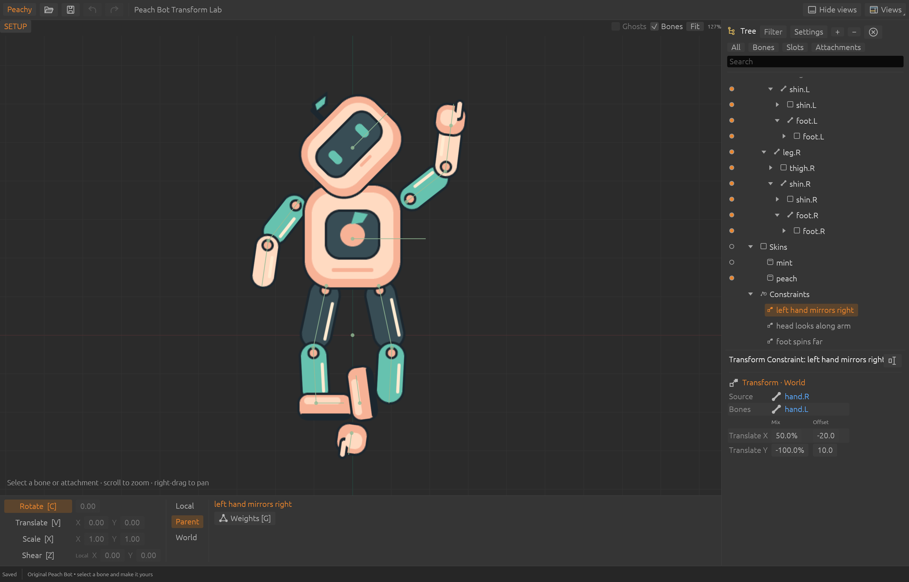

# Transform constraints (world subset) — November 9, 2026

This records the November 9 foundation and November 10 same-property remapping
checkpoint. The November 15 [world X-to-Rotate continuation](transform-mapping-authoring.md)
adds one evaluated cross-property mapping, observed Properties controls and
shared semantic range authoring. Bounded native/MCP/runtime/Editor acceptance
passes; historical refusal/UI statements below are scoped to their dated checkpoints.
The current native format is **22**, with no format change for that continuation.

Thirteen of the game's skeletons use Spine 4.3 transform constraints. All 17 of
their constraints use the default world mode with identity Rotate/X/Y mappings,
sometimes with negative (mirroring) mixes. This slice stores the complete 4.3
data in native v11 and evaluates that subset exactly.

## Data (native v11)

`Constraint::Transform` holds constrained bones, source, six offsets
(`rotation`, `x`, `y`, `scaleX`, `scaleY`, `shearY`), six setup mixes, general
property mappings (`from` offset → `to` targets with offset/max/scale) and the
`localSource`, `localTarget`, `additive`, `clamp` flags, so later slices need no
new format. Observed defaults: a mapped property's mix defaults to 1, `mixY` to
`mixX`, `mixScaleY` to `mixScaleX`; unmapped mixes are forced to zero by the
runtime, so a nonzero unmapped mix is refused rather than silently kept.
Constraints run in list order, interleaved with IK; physics stays data only.

## Evaluated subset — November 9 checkpoint

World source and target, not additive or clamped, identity Rotate/X/Y mappings
with neutral offsets and scale. Rules fitted to 300 random black-box runtime
observations (max error 1e-6):

- **Rotate:** turn the bone's world frame toward the source's world X-axis angle
  plus the rotation offset — subtracted when the source frame is mirrored — by
  mixRotate, with one ±180° correction.
- **X / Y:** move the bone's world origin toward the source frame applied to the
  (x, y) offset, by mixX / mixY.

The result is written back as the bone's applied local transform (rotation and
Scale X from the X axis, Scale Y and Shear Y from the Y axis), so children,
bindings and tools stay consistent. Constrained bones must inherit normally and
must not contain the source or each other.

Refused at that checkpoint: local/additive/clamped modes, remapping (offsets, scale or
cross-property mappings — the cow front rig uses this), scale and shear mappings,
transform timelines and skin-required constraints.

## IK under transformed ancestors

While verifying these rigs, IK's Phase A restriction on ancestors was lifted:
ancestors may have any scale, shear or reflection. Our solve matched the runtime
for uniform, nonuniform, sheared and mirrored ancestors (1,800 values per
category, max error 2.8e-5), with IK moving bones by a median 27 units. The
constrained bones themselves still need unit scale and zero shear.

## Remapping — November 10, 2026

The cow front maps X and Y with offsets (`"x": {"offset": 131.2, "to": {"x":
{"offset": 284.05, "max": 384.05}}}`). Black-box probes of the external
runtime with original rigs give, for each coordinate p of the source point:

    value = (p − from offset) × scale + to offset

With `clamp`, the value is kept between the to offset and `max` (either order;
`max` defaults to 1 and is ignored without `clamp`). The mix then moves the
bone toward the value as before, including negative mixes. Rotate keeps the
identity-only rule (and is refused when clamped), because no shipped rig remaps
it.

The original Transform Map Lab (`transform-map-bot.peachy`) remaps the hand
mirror with offsets and negative/fractional scales, and clamps the left foot to
a box whose X range the source crosses. It matches the runtime at every
sample. At the November 10 checkpoint the properties panel showed imported
mappings without editable ranges. The bounded X-to-Rotate endpoint controls
below extend that UI; general mapping creation/editing is still unsupported.

## World Translate X to Rotate — November 15 continuation

One world-space Translate X source may drive one constrained Rotate property,
with source/target offsets, scale, Clamp and Rotate mix. The shared evaluator
keeps the established same-property paths and refuses unsupported domains and
consumer precision disagreements explicitly. Local/additive modes, other
cross-property destinations, duplicate Rotate writers, one-to-many mapping and
Transform timelines remain outside this slice. See the
[measured behavior and precision boundary](transform-mapping-authoring.md).

The Tree inspector now follows the installed 4.3.26 Source/Targets links,
expandable Offset/Mix, six-row Properties table and Options. Colored nodes and
a connection show X→Rotate; source Min/Max are on the left and target Min/Max
on the right. The endpoint fields use `transform_mapping_range` and the shared
`EditTransformMappingRange` operation. The pure
`edited_transform_mapping_range` helper advances accepted preview candidates
inside one frozen Session transaction. Equal endpoints repair Max to Min+100;
reversed endpoints remain reversed. Raw scale zero leaves Source Max undefined
and blank until genuine finite entry resolves it; viewing/focus never rewrites
the raw constraint.

Mix Rotate uses numeric percent input plus a slider. For this cross mapping,
expanded Offset shows paired Translate X/Y numerics and sliders, rather than
an ineffective Rotate offset. The rails extrapolate outside their nominal
−50..50 span. Unsupported Match/local/additive alternatives stay disabled.
The natural-width table and Offset group scroll horizontally in a narrow Tree,
and the outer Properties scrollbar reserves its hit area. Setup owns edits;
Animate remains read-only because Transform timeline authoring is absent.

Actual native input has verified endpoint repair/reversal, Clamp, Mix 50%,
one-step Undo/Redo, held Escape/secondary-button blocking, Offset X 12.5 and
rail extrapolation to 77.1028 with cancellation, owned-field Save/stale-Enter
protection and pending 13.5-degree pose exclusion from Save. Native and MCP
authoring reach identical canonical saved data. Shared engine/MCP checks,
external runtime comparisons and exact installed-editor interchange also pass
within the documented scope. Final native input verifies the rebuilt right-edge
Mix drag/Escape, zero-scale blank/no-op redo/typed-zero repair, actual 1120×740
range/Clamp/Offset Y edits with exact Undo, and fresh no-history public reopen
with its image. Playback time advances with Loop enabled and Q stops at time 0;
boundary wrapping was not observed. See the [capture gallery](../evidence/transform-mapping.html)
and [public lab](../../examples/peach-bot/transform-mapping-bot.peachy).
Tree-pane resizing remains unverified after a staged edge drag made no width
change. Native scrolling proves control access, not resize parity. This is
bounded mapping acceptance, not full Transform/UI parity.
