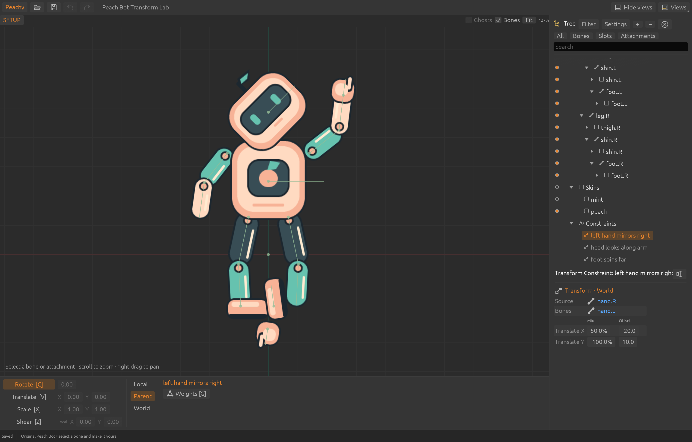

# Transform constraints (world subset) — November 9, 2026

Thirteen of the game's skeletons use Spine 4.3 transform constraints. All 17 of
their constraints use the default world mode with identity Rotate/X/Y mappings,
sometimes with negative (mirroring) mixes. This slice stores the complete 4.3
data in native v11 and evaluates that subset exactly.

## Data (native v11)

`Constraint::Transform` holds constrained bones, source, six offsets
(`rotation`, `x`, `y`, `scaleX`, `scaleY`, `shearY`), six setup mixes, general
property mappings (`from` offset → `to` targets with offset/max/scale) and the
`localSource`, `localTarget`, `additive`, `clamp` flags, so later slices need no
new format. Observed defaults: a mapped property's mix defaults to 1, `mixY` to
`mixX`, `mixScaleY` to `mixScaleX`; unmapped mixes are forced to zero by the
runtime, so a nonzero unmapped mix is refused rather than silently kept.
Constraints run in list order, interleaved with IK; physics stays data only.

## Evaluated subset

World source and target, not additive or clamped, identity Rotate/X/Y mappings
with neutral offsets and scale. Rules fitted to 300 random black-box runtime
observations (max error 1e-6):

- **Rotate:** turn the bone's world frame toward the source's world X-axis angle
  plus the rotation offset — subtracted when the source frame is mirrored — by
  mixRotate, with one ±180° correction.
- **X / Y:** move the bone's world origin toward the source frame applied to the
  (x, y) offset, by mixX / mixY.

The result is written back as the bone's applied local transform (rotation and
Scale X from the X axis, Scale Y and Shear Y from the Y axis), so children,
bindings and tools stay consistent. Constrained bones must inherit normally and
must not contain the source or each other.

Refused for now: local/additive/clamped modes, remapping (offsets, scale or
cross-property mappings — the cow front rig uses this), scale and shear mappings,
transform timelines and skin-required constraints.

## IK under transformed ancestors

While verifying these rigs, IK's Phase A restriction on ancestors was lifted:
ancestors may have any scale, shear or reflection. Our solve matched the runtime
for uniform, nonuniform, sheared and mirrored ancestors (1,800 values per
category, max error 2.8e-5), with IK moving bones by a median 27 units. The
constrained bones themselves still need unit scale and zero shear.

## Remapping — November 10, 2026

The cow front maps X and Y with offsets (`"x": {"offset": 131.2, "to": {"x":
{"offset": 284.05, "max": 384.05}}}`). Black-box probes of the external
runtime with original rigs give, for each coordinate p of the source point:

    value = (p − from offset) × scale + to offset

With `clamp`, the value is kept between the to offset and `max` (either order;
`max` defaults to 1 and is ignored without `clamp`). The mix then moves the
bone toward the value as before, including negative mixes. Rotate keeps the
identity-only rule (and is refused when clamped), because no shipped rig remaps
it.

The original Transform Map Lab (`transform-map-bot.peachy`) remaps the hand
mirror with offsets and negative/fractional scales, and clamps the left foot to
a box whose X range the source crosses. It matches the runtime at every
sample. The properties panel shows imported mappings; editing them is not
supported yet.
